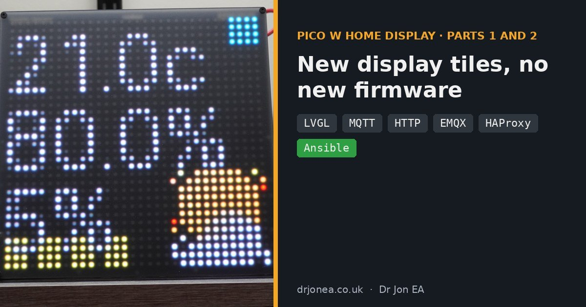
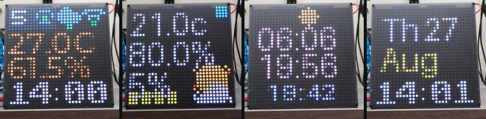
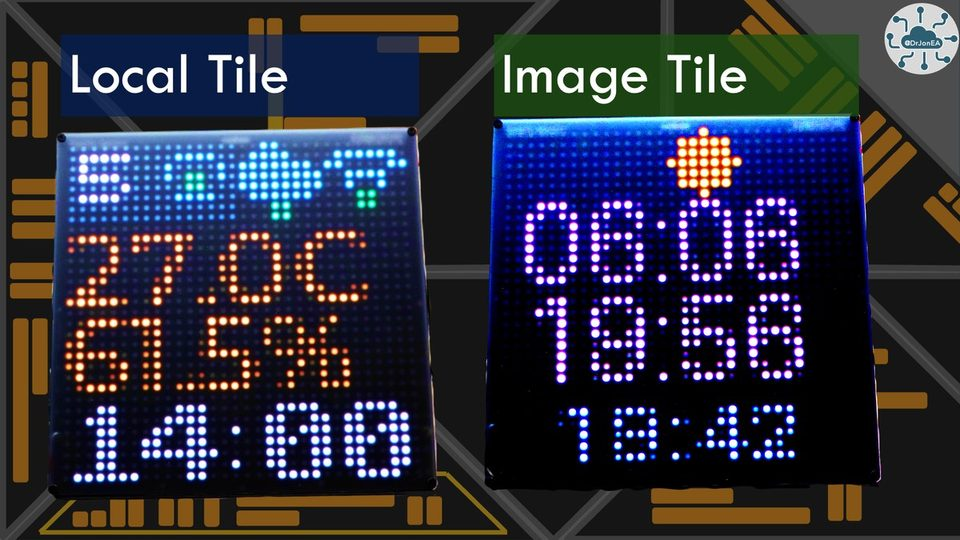
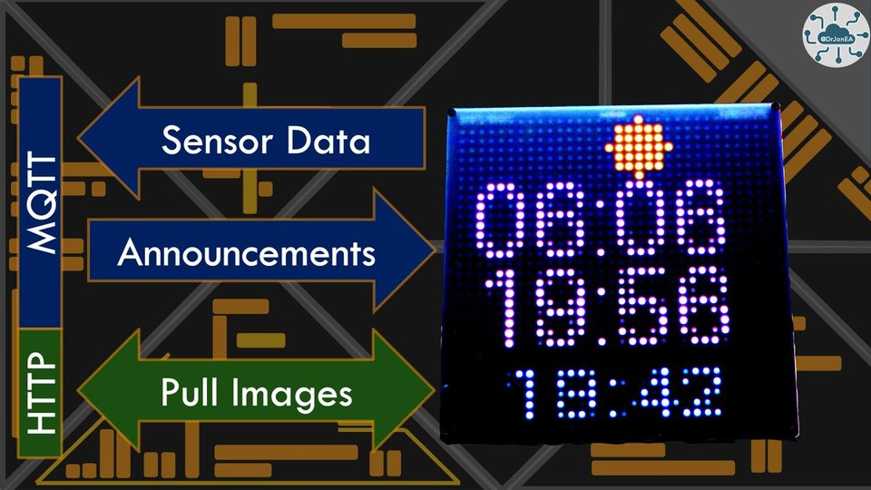
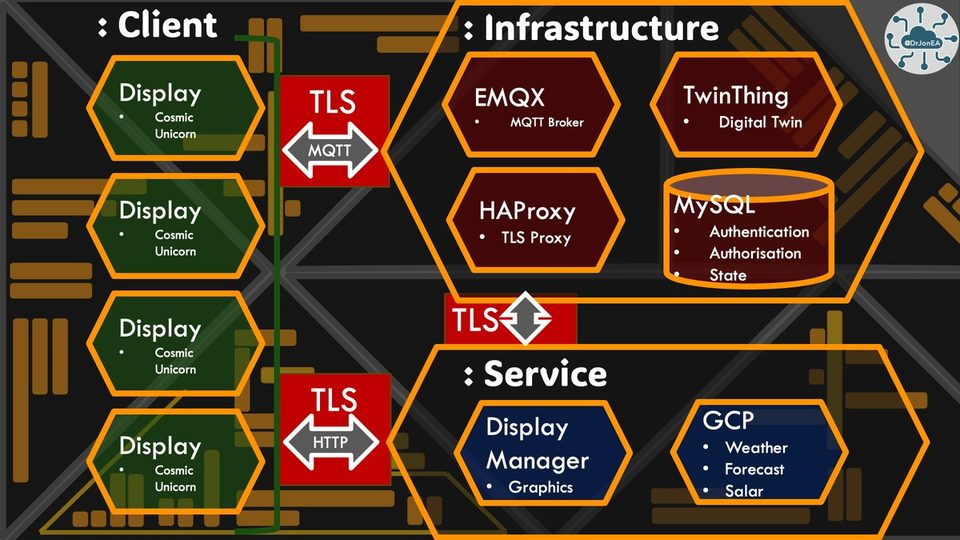
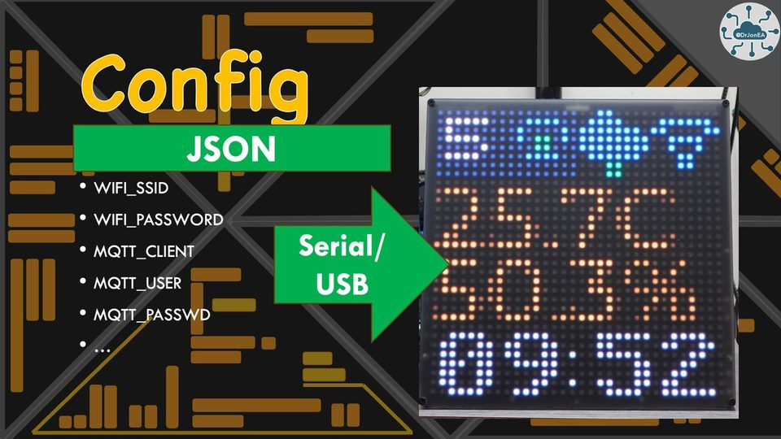
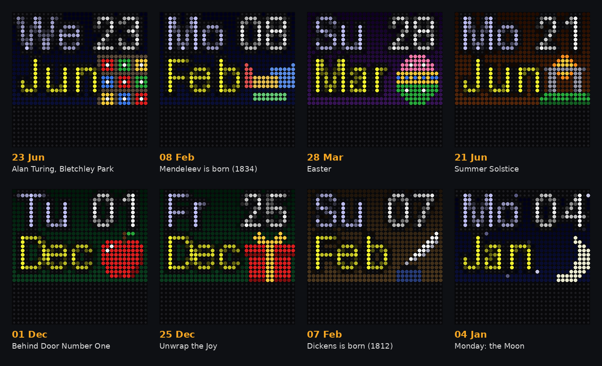
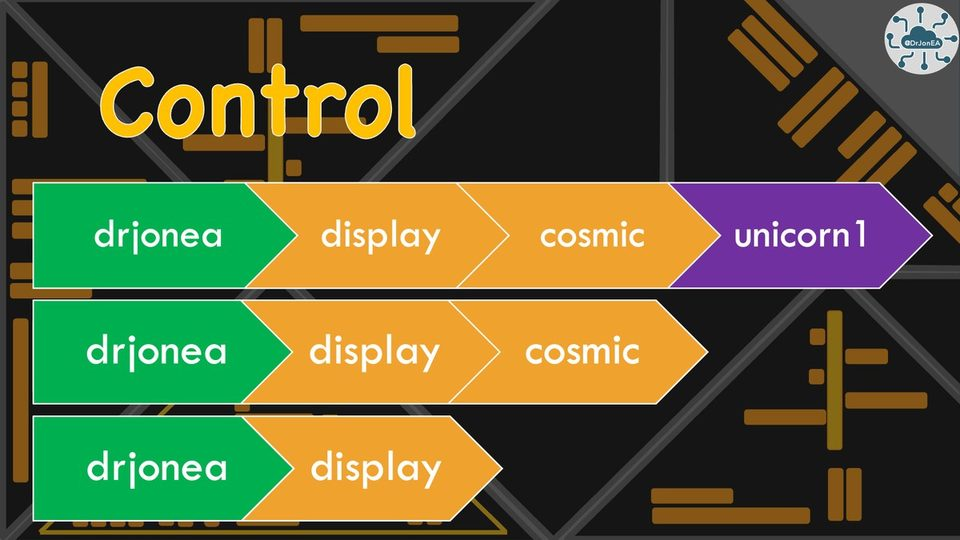

# DrJonEAHomeDisplay



A display control architecture for my home. Initially using the 
[PIMORONI Cosmic Unicorn V1](https://shop.pimoroni.com/products/space-unicorns?variant=40842626596947).
Each device is a IoT devices publishing temperature and humidity (from AHT10) over MQTT. 
Then responding to commands over MQTT to provide details of what to share.

To allow a Cosmic Unicorn to adapt to different data to visualise I went with a simple LVGL two tile 
architecture. A local tile that just displays local data: Clock, Temperature, Humidity and Status. Plus a 
Image tile that pulls an image of HTTP to display. Overlays of clock and scroll text are also supported.





MQTT carries sensor data out and announcements in. When a new tile is ready, the display pulls the image over HTTP.



## Cloning and Building
This is a Pico SDK based project in C++. Where libraries are included as submodules. When cloning please
recurse submodules. 

I have a blog that explains how to clone repos and build my projects on 
[drjonea.co.uk](https://drjonea.co.uk/2025/12/15/building-my-projects-from-repo/).

## Libraries
The libraries I am using for this is PIMORONI's driver for the Cosmic Unicorn plus LVGL v9.5. For MQTT
I am using CoreMQTT and coreMQTT-Agent from FreeRTOS plus FreeRTOS Kernel. For HTTP I am using
coreHTTP. Plus some libraries for JSON and URL decoding.

Right now I am not securing the data transport but that is a longer term plan. WolfSSL is in the build as a
TLS library for when I add this capability.

The server for this architecture is the Display Manager in the *manager* folder, written in Python with
Flask, Paho and Pillow (see [Server](#server-display-manager) below). Earlier experiments are in the *exp* folder.

The MQTT broker, TLS proxy and digital twin infrastructure are in a separate repo,
[oracIoTHub](https://github.com/DrJonEA/oracIoTHub) (EMQX, HAProxy, TwinThing and Ansible roles).



## Firmware

### Cosmic Unicorn V1
Firmware build is targetted at the Cosmic Unicorn using a Pico W. Other firmware may be added over time.

Unit can be configured over USB Serial by sending a JSON string. See *exp/pyConfig* as example.



### Network speed test
A display can measure its own network upload speed and report it in its device state.

To start a test, send a display command over MQTT that contains a `speedtest` key. The value is
ignored, for example:
```json
{"speedtest": true}
```
The display then POSTs 100 KB to `<httpConn>/speedtest`, where `<httpConn>` is the display's
configured HTTP server. It times the request, and if the server answers `200` it sets `mbps` in the
device state to the upload speed in megabits per second. The new value goes out with the next state
update, alongside `wifiRSSI`, so you can compare speed and signal strength.

- The payload is just a copy of the Pico's RAM, so the server should accept any body and ignore its
  content. The request is sent as `Content-Type: application/json`, so the endpoint must not try to
  parse it.
- The time includes connecting, sending the headers and waiting for the response, so `mbps` slightly
  understates the raw transfer rate.
- To give TCP enough memory for a fast upload, lwIP's `MEM_SIZE` is now 16 KB (it was 4000 bytes) in
  *port/lwip/lwipopts.h*.
- The Display Manager provides this endpoint: `POST /speedtest` reads and discards the body and returns
  `200`. It also runs the test on every display every 10 minutes (see [Network sweep](#network-sweep)).
- The result also goes out in the display's next sensor report (see below), about 10 seconds later.

### Sensor reports and ping
Ten seconds after it last handled a command (`TILE_TIME_MS` in *TileAgent.h*), a display publishes a
sensor report to `<ORG>/sensor/<group>/<clientid>`:
```json
{"id": "studycosmic", "temperature": 21.57, "humidity": 46.84, "mbps": 8.08, "rssi": -58}
```
`sendSensors()` in *TileAgent.cpp* currently closes the JSON object twice, so reports end with a stray
`},`. The Display Manager ignores anything after the first complete object.

Each display also answers TwinThing pings from *lib/twinThingPico1-2W*. It listens on
`TNG/<clientid>/TPC/PING`, `GRP/<group>/TPC/PING` and `GRP/ALL/TPC/PING`, and replies on
`TNG/<clientid>/TPC/PONG` with the ping's payload plus its IP address:
```json
{"id": 0, "ip": "192.168.22.115"}
```
- The pong is built in a fixed buffer, `MAXPINGPAYLOAD` in *MQTTPingTask.h*. It must hold the ping
  payload plus the IP (about 25 bytes more), so it is set to 80 bytes. The original 20 overflowed.
- The ping task waits 20 ms before replying, which is included in any MQTT ping time.

## Server: Display Manager
The Display Manager (*manager/*) is a Flask app that generates the 32x32 tiles the displays download,
publishes display commands and clock data over MQTT, and serves a web dashboard.


### Running
```
cd manager
pip install -r requirements.txt
python main.py
```
It listens on port 5000. Configuration is by environment variable:

| Variable | Purpose | Default |
|---|---|---|
| `MQTT_HOST`, `MQTT_PORT` | MQTT broker | port 1883 |
| `MQTT_CLIENT`, `MQTT_USER`, `MQTT_PASSWD` | MQTT credentials | |
| `SMARTCLOCKGOOGLE` | Google Weather API key | |
| `WEATHER_LAT`, `WEATHER_LNG` | Location for weather and sun/moon times | Brighton, UK |
| `DISPLAY_TIMEZONE` | IANA timezone for the clock offset and calendar date | `Europe/London` |
| `CALENDAR_THEMES_DIR` | Calendar theme collections | `manager/calendar_themes` |
| `CALENDAR_IMAGE_DIR` | Calendar theme images | `manager/static/img/calendar` |
| `SENSOR_TOPIC` | MQTT subscription for sensor node readings | `drjonea/sensor/#` |
| `UNIFI_API_KEY`, or `UNIFI_USER` and `UNIFI_PASSWD` | UniFi gateway login for the external network view; leave unset to disable it | |
| `UNIFI_HOST`, `UNIFI_SITE` | UniFi gateway address and site | `192.168.1.1`, `default` |
| `UNIFI_CA_FILE` | CA bundle for the gateway's certificate (TLS isn't verified without it) | |
| `WAN_PING_TARGETS` | Hosts to ping if the gateway's own latency monitors can't be read | Google, Microsoft, 1.1.1.1, AWS |

Run it detached from a terminal (for example as a systemd service, or with `nohup ... > manager.log 2>&1`).
All runtime output goes through `logging`.

### Tiles
Each tile is available as a PNG for viewing and as BRG565 for the displays:

| Tile | PNG | Display |
|---|---|---|
| Current weather | `/weather.png` | `/32x32/weather.brg565` |
| Today's forecast | `/forecast.png` | `/32x32/forecast.brg565` |
| Sun and moon paths | `/solar.png` | `/32x32/solar.brg565` |
| Calendar | `/32x32/cal.png` | `/32x32/cal.brg565` |
| Pride flag | `/32x32/pride.png` | `/32x32/pride.brg565` |
| Sensors: temperature and humidity, all nodes | `/32x32/env.png` | `/32x32/env.brg565` |
| Sensors: Mbps and WiFi signal, all nodes | `/32x32/net.png` | `/32x32/net.brg565` |
| Sensors: one node, with 24h trend | `/32x32/env/<node>.png` | `/32x32/env/<node>.brg565` |
| Network: one node, with 24h trend | `/32x32/net/<node>.png` | `/32x32/net/<node>.brg565` |
| Ping: ICMP and MQTT round trip, all nodes | `/32x32/ping.png` | `/32x32/ping.brg565` |
| Ping: one node, with 24h ICMP trend | `/32x32/ping/<node>.png` | `/32x32/ping/<node>.brg565` |
| External network: ISP speed, cloud latency, 24h WAN traffic | `/32x32/wan.png` | `/32x32/wan.brg565` |

The calendar tile accepts `?date=dd/mm/yyyy` to preview any day, e.g. `/32x32/cal.png?date=25/12/2026`.

### Sensor nodes
Nodes publish readings to `drjonea/sensor/<group>/<node>` as JSON, for example
`{"id": "studycosmic", "temperature": 21.5, "humidity": 46.8, "mbps": 8.1, "rssi": -58}`. Every field
is optional, and the node ID falls back to the last topic segment. The manager keeps each node's latest
values and 24 hours of history in memory (lost on restart), and marks a node stale after 10 minutes
without a message. `/sensors` returns the cache as JSON.

- **Overview tiles** (`env`, `net`) show up to four nodes, one 8-pixel row each, starting with a stripe in
  the node's colour. Nodes keep their colour in the order they were first seen. `env` shows temperature
  (blue under 16 °C, cyan to 19, green to 24, yellow to 27, red above) and humidity % (orange under 30,
  cyan to 60, blue above). `net` shows Mbps, a ping summary and four WiFi signal bars (-55, -67, -75
  and -85 dBm). The ping summary is two blocks, ICMP then MQTT, coloured by round trip (ICMP: green
  under 50 ms, yellow under 200; MQTT: green under 500 ms, yellow under 1200, since it normally takes
  about 800 ms; red above, or when nothing replied; dark when not yet measured).
  Stale nodes are dimmed and listed last.
- **Node tiles** (`env/<node>`, `net/<node>`) show the main reading at double size, the second reading
  below it, and a 24-hour trend along the bottom 11 rows, scaled to that day's own range.
- **Ping tiles** show the ICMP round trip on the left and the MQTT round trip on the right of each
  row, in ms, coloured with the same bands as the `net` ping summary. An ICMP `--` in red means every echo was
  lost. The node tile shows ICMP at double size, MQTT below it, and a 24-hour ICMP trend.
- Overview tiles return `503` until a node has reported, and node tiles return `404` for an unknown node.

### Network sweep
Every 10 minutes (at :07, :17 ... :57, minutes when no display preset is announced, so tile downloads
don't skew the figures) the manager measures each live sensor node in three stages:

1. **MQTT ping:** five `{"id": n}` pings to `GRP/display/TPC/PING`, one second apart, timed against
   the pongs on `TNG/<node>/TPC/PONG`. The median is stored as `mqtt_ms`, the share of pings with no
   pong as `mqtt_loss` (%), and the node's IP is taken
   from the pong's `ip` field. This is the full round trip through the broker and the firmware.
2. **ICMP ping:** ten echoes to each node's IP. The median is stored as `icmp_ms` and the loss as
   `icmp_loss` (%). This is the network round trip alone. It uses unprivileged ICMP sockets
   (`icmplib`), which work without root on macOS and in Docker 20.10+; on a bare Linux host the
   `net.ipv4.ping_group_range` sysctl must include the manager's group.
3. **Speed test:** `{"speedtest": true}` to each node's own display topic, for example
   `drjonea/display/cosmic/studycosmic`, one node at a time. The sweep waits for the node's next sensor
   report (which carries the new `mbps`, about 10 seconds later) before testing the next node, so the
   uploads never compete.

You can also start a sweep from the dashboard (see [Web dashboard](#web-dashboard)), or with
`curl -X POST -d stages=speed http://<server>:5000/network-sweep/run` (`stages` is `all`, `speed` or
`ping`). The pings run first, while the network is quiet. The sweep runs on its own thread, so it doesn't delay
the other scheduled jobs, and a sweep that is still running when the next slot comes round is skipped.
The manager's MQTT account needs permission to publish to `GRP/display/TPC/PING` and the display
topics, and to subscribe to `TNG/+/TPC/PONG`. If the broker refuses the pong subscription, the manager
logs an error, skips the MQTT ping stage, and shows a note in the Network Tests panel. Without that check,
every node would look as if it had stopped answering. Without pongs there are no IP addresses, so ICMP is
skipped too.

### External network
With UniFi credentials set, the manager reads the gateway (tested against a UCG Ultra) every 5 minutes
(at :04, :09 ... :59), using the UniFi Network API under `/proxy/network/api`:

- **ISP:** name, WAN IP, internet latency, uptime and drops, from `stat/health`.
- **ISP speed tests:** the last 7 days from `stat/report/archive.speedtest`. The newest result is used as
  the last speed test, because the health summary reports 0 and "Idle". Turn on the gateway's scheduled
  speed test (Settings > Internet > WAN) to build a history.
- **WAN throughput:** the current rate, and 5-minute (24 hours) and daily (7 days) WAN byte reports.
- **Cloud latency:** the gateway's own latency checks, which the UCG Ultra reports in `stat/health`
  under `wan.uptime_stats.WAN` in two lists:
  - `monitors`: the console's internet latency view, e.g. Microsoft, Google and 1.1.1.1. These come first.
  - `alerting_monitors`: WAN health checks, e.g. ping.ui.com, 1.1.1.1 and 8.8.8.8. These are added only
    for targets not already listed.

  If neither list is found, the manager pings `WAN_PING_TARGETS` itself with `icmplib`. The dashboard
  shows the source of each figure, and which targets didn't fit on the tile.

Use an API key (Settings > Control Plane > Integrations) or a local-only, read-only ("View Only")
account. Ubiquiti cloud accounts with MFA can't log in this way. *exp/Unifi/unifiStats.py* runs the
same reads from the command line, with `--raw` to dump the JSON, and reports where it finds latency
monitors.

The `wan` tile shows:

- rows 0-4: ↓ ISP download Mbps, and internet latency on the right
- rows 6-10: ↑ ISP upload Mbps
- rows 12-22: up to four cloud targets as a letter and ms (G Google, M Microsoft, C Cloudflare,
  A Amazon, U Ubiquiti, Q Quad9, F Facebook; other IP addresses use their first digit, e.g. 8 for
  8.8.8.8, and anything else shows ?), coloured green under 30 ms, yellow under 80, red
  above or no reply
- rows 24-31: 24 hours of WAN traffic, download in cyan and upload in orange, on one Mbps scale

The download and upload figures are drawn in the same colours as their trend lines. The tile returns
`503` until the gateway has been read. `/wan` returns the data as JSON.

### Schedule
A background scheduler refreshes data and re-announces display presets on fixed minutes past the hour:
weather every 15 minutes, forecast every 30, and the calendar preset hourly. Every minute it publishes
`{"tz": <UTC offset in minutes>, "blue": <bool>}` to `drjonea/display`, so the displays keep local time
across daylight saving changes; `blue` is true during the night window (20:00 to 05:00 local).

### Web dashboard
`http://<server>:5000/` shows the uplink status, the active widgets, all tiles, the sensor nodes with
their latest readings and tiles, the network sweep results, and preset and console controls for
publishing commands.

The **Network Tests** panel shows whether a sweep is running and which stage it is on, when the last one
ran, and when the next is due. For the latest run it lists each node's MQTT ping (median, min-max,
pongs received), ICMP ping (median, min-max, jitter, loss) and speed test (outcome, Mbps, time taken),
plus any problems such as ICMP being unavailable. Below that is a summary of the previous nine runs.
**SPEED TESTS** re-runs just the speed tests and **FULL SWEEP** runs all three stages. While a run is in
progress the panel refreshes every two seconds. The same data is available as JSON from
`/network-sweep`.

The **External Network** panel shows the `wan` tile, ISP and WAN IP, the last speed test, internet
latency, uptime and drops, current traffic, and when the data was read. It also has a table of cloud
latencies with their source, 24-hour throughput totals, averages and peaks, a per-day table for the last
7 days, and the last 10 speed tests. **REFRESH NOW** reads the gateway straight away.

The **Sensor Nodes** panel shows the `env`, `net` and `ping` overview tiles, and a table of every node
with its group, latest readings (temperature, humidity, Mbps, RSSI, ICMP and MQTT times, packet loss), IP
address, how long ago it reported, and previews of its node tiles. Stale nodes are greyed out.

The **Today's Calendar Theme** panel shows today's date and tile, the
theme's description, the set it came from, the rule that chose it, and any other themes that also match
today but were outranked.

### Calendar themes


*Calendar tiles rendered from the theme collections (the clock fills the blank bottom rows on the display).*

The calendar tile shows the day of week, date and month over a themed 32x22 background image. The bottom
10 rows are left clear, because the display draws its clock there. Themes are defined in JSON
*collections*, one file per set, in *manager/calendar_themes/*. They are re-read on every request, so
edits take effect without a restart.

```json
{
    "description": "Family birthdays.",
    "priority": 100,
    "defaults": {"outline": "#000000"},
    "annual": {
        "13/01": {"title": "Kevin's Birthday", "image": "birthday_kevin.png"}
    }
}
```

A collection can contain any of these rule kinds. When several rules match a day, the **rule kind** decides
first, in this order:

1. `dates`: one specific day, `"dd/mm/yyyy"`
2. `events`: dates calculated each year. These are `easter`, `spring_equinox`, `summer_solstice`,
   `autumn_equinox` and `winter_solstice`. Solstices and equinoxes are placed on the local date.
3. `annual`: the same day every year, `"dd/mm"`
4. `weekdays`: the day of the week, e.g. `"monday"`

If two rules of the same kind match, the collection with the higher `priority` wins. So an entry in
`overrides.json` (a specific date) always wins, and the weekday themes only show on otherwise free days.
Each rule holds a theme: `title`, `image`, an optional text `outline` colour, and optional per-field
`text` colour and position overrides. A collection can also define named `themes` that any collection
reuses by name, and can be switched off with `"enabled": false`. The full format is documented in
*manager/app/calendar_themes.py*.

The current sets, highest priority first:

| Collection | Priority | Contents |
|---|---|---|
| overrides | 1000 | One-off specific dates (empty) |
| birthdays | 100 | Family birthdays |
| seasonal | 80 | Easter, spring and autumn equinoxes, summer solstice |
| advent | 70 | A theme for every day of December |
| tolkien | 50 | The Hobbit and Lord of the Rings anniversaries |
| doctorwho | 45 | Doctor Who episodes and milestones |
| bladerunner, blakes7, scifi, terminator | 40 | Blade Runner, Blake's 7, Alien/Prometheus/Star Trek/Matrix, Terminator |
| marvel | 30 | MCU dates and Marvel debut days |
| midkemia | 20 | Raymond E. Feist's Midkemian calendar |
| computing | 18 | History of computing (Unix and open technology) |
| chemistry | 17 | History of chemistry |
| dickens | 15 | Charles Dickens and the Victorian era |
| weekdays | 10 | Norse and planetary day-of-week themes, and the default |

### Calendar tools
- **`python manager/tools/calendar_report.py [YEAR] [--all]`** lists every themed day of a year, with the
  rule that chose it and anything it hides. It then checks for missing images, unknown theme names,
  duplicate keys and unused images, and exits non-zero on a problem, so it can be run as a check before
  deploying.
- **`python manager/tools/make_calendar_images.py`** regenerates the theme images in
  *manager/static/img/calendar/*. Each image is drawn from a 12x12 ASCII pixel-art sprite in the
  `*_images.py` modules next to it, placed in the corner the text leaves free. To change an image, edit its
  sprite and rerun. Images can also be drawn by hand: any 32x22 PNG works, and other sizes are scaled to
  fit.

## Topics Used
Relative to topic <ORG> which can be set as a parameter. Defaults to drjonea



- drjonea/display/cosmic/<clientid>	
- drjonea/display/cosmic
- drjonea/display
- drjonea/sensor/cosmic/<clientid>

TwinThing topics used for ping (not under <ORG>):

- GRP/display/TPC/PING, GRP/ALL/TPC/PING and TNG/<clientid>/TPC/PING: ping a group, everything, or one display
- TNG/<clientid>/TPC/PONG: a display's reply, with its IP address

## Provisioning with Ansible
*ansible/roles* holds two roles, used alongside the EMQX roles in
[oracIoTHub](https://github.com/DrJonEA/oracIoTHub):

- **OracIotDisplay** creates a display's MQTT user and ACLs (`purge.json`, `thing.json`,
  `display.json`) and then provisions the hardware over USB serial from the provisioning server, with
  Wi-Fi, MQTT and HTTP settings.
- **OracIotDisplayManager** creates the Display Manager's MQTT user and ACLs (`purge.json`,
  `thing.json`, `displaymanager.json`).

Both work out the MQTT password the same way:

1. Use `passwd` if it is given and not blank.
2. Otherwise use the password stored for that user, read from the `shadow` column of `mqtt_user` and
   decrypted with `mqtt_shadow_key`.
3. Otherwise generate a random 20-character password.

The password is printed by the "Display MQTT Password as debug" task. After the ACL roles have run, it is
written back to `shadow`, encrypted, so later runs reuse it. This step is needed because `purge.json`
deletes and re-creates the user without `shadow`. Without it, a stored password would be lost, and every
run would set a new one and lock out whatever is using the old one. After the first run for the Display
Manager, set the printed password as its `MQTT_PASSWD`.

---

## More from Dr Jon EA

- 📺 **Videos:** [Part 1: MQTT + HTTP: The Unusual Architecture Behind My Pico W Display](https://youtu.be/Bp9ovLeLuKA) · [Part 2: EMQX + HAProxy + Ansible: The IoT Stack Behind My Pico W Display](https://youtu.be/ck1F96P57RM)
- 📝 **Write-up:** [New Tiles, No New Firmware: My Pico W Cosmic Unicorn Display and the IoT Stack Behind It](https://drjonea.co.uk/2026/11/09/cosmic-unicorn-pico-w-home-display-mqtt-http-emqx-haproxy-ansible/)
- 🛠️ **Building my projects:** [How to clone and build from my repos](https://drjonea.co.uk/2025/12/15/building-my-projects-from-repo/)
- 🎓 **Courses and training:** [drjonea.co.uk/training](https://drjonea.co.uk/training/)

Made by [Dr Jon Durrant](https://jondurrant.com) at [Dr Jon EA Ltd](https://drjonea.co.uk) · [YouTube](https://www.youtube.com/@drjonea)
